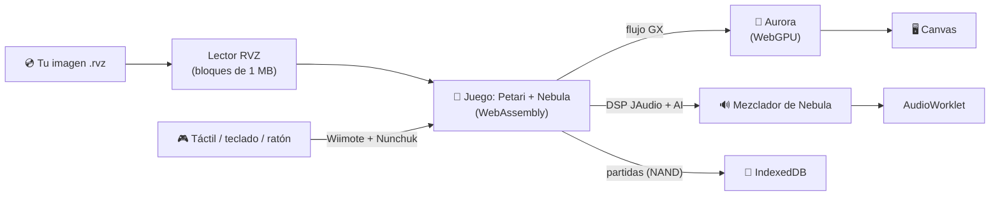

<div align="center">


# 🌌 Galaxy Web Port

### Un port experimental de *Super Mario Galaxy* al navegador

**El código original del juego, compilado a WebAssembly y dibujado con WebGPU.**
**Sin instalar nada. Sin emulador. Con tu propia copia del juego.**

[](#-estado-del-proyecto)
[](#-novedades-de-la-011-experimental)
[](LICENSE)

[](#-cómo-funciona)
[](#-requisitos)
[](#-requisitos)

### [▶ Probar en el navegador](https://gonzaloprogame.github.io/Super-Mario-Galaxy-Web/)

[Requisitos](#-requisitos) ·
[Copyright](#%EF%B8%8F-aviso-de-copyright-y-legalidad) ·
[Estado y fallos](#-estado-del-proyecto) ·
[Cómo jugar](#-cómo-jugar) ·
[Preguntas](#-preguntas-frecuentes) ·
[Compilar](#%EF%B8%8F-compilar-desde-el-código)


</div>

---

> [!WARNING]
> ### 🚧 Versión experimental: todavía no se puede jugar de principio a fin
> Esta es la **primera versión pública** y tiene **fallos conocidos y por descubrir**. Hoy se puede llegar
> a la pantalla de título, elegir un archivo, ver el prólogo y **jugar el primer nivel**, pero **el juego no se puede
> completar**: más allá de ese punto apenas se ha probado, puede haber errores gráficos, cuelgues, sonidos que
> fallen o partes que vayan lentas.
>
> **Aun así, es un buen comienzo.** Que el código original del juego arranque, dibuje un nivel completo, suene,
> responda a los controles y guarde la partida dentro de una pestaña del navegador era el paso más difícil. Lo que
> queda es avanzar nivel a nivel, corregir lo que aparezca y ganar velocidad. 🌟

> [!IMPORTANT]
> ### 🛑 Este repositorio no contiene ningún archivo de Nintendo
> Ni ROM, ni ejecutables, ni modelos, texturas, música, vídeos ni logotipos del juego. **Necesitas tu propia
> copia** de *Super Mario Galaxy*, hecha a partir de **tu** disco. Lee el
> [aviso de copyright](#%EF%B8%8F-aviso-de-copyright-y-legalidad) antes de usarlo.

---

## ✨ Qué es

**Galaxy Web** ejecuta **la lógica original de *Super Mario Galaxy*** dentro del navegador. No es un remake, ni un
clon, ni un emulador de Wii:

- 🧠 **El juego:** la decompilación [Petari](https://github.com/SMGCommunity/Petari), en el fork nativo de
  [Nebula](https://github.com/keepvaibin/nebula), compilada a **WebAssembly** con Emscripten. Es el código del juego
  traducido a C++, no una imitación.
- 🎨 **Los gráficos:** cada orden gráfica del juego (el flujo GX de la consola) llega a
  [Aurora](https://github.com/encounter/aurora), que la traduce y la dibuja con el **WebGPU** del navegador.
- 🔊 **El sonido:** el programa de audio del juego (el DSP de JAudio) se mezcla con la implementación de Nebula y
  suena a través de un `AudioWorklet`.
- 💿 **El disco:** la página lee tu imagen **RVZ** de Dolphin **directamente y por trozos**, sin claves de la
  consola ni conversiones. **El archivo nunca sale de tu dispositivo.**
- 💾 **Las partidas:** se guardan en el propio navegador (IndexedDB) y se recuperan al volver.

## ⚙️ Cómo funciona



Todo ocurre **en tu navegador**: no hay servidor que ejecute el juego, no se suben archivos a ninguna parte y la
página funciona como un sitio estático (GitHub Pages).

---

## 🖥️ Requisitos

> [!NOTE]
> Estas cifras salen de lo que se ha medido hasta ahora: un teléfono Android de gama media-alta (unos **27 fps** en
> el primer nivel) y un equipo de escritorio con Chrome. Son **orientativas** y se irán ajustando con más pruebas.
> Si lo pruebas en otro dispositivo, ¡cuéntanos cómo va!

| | 🟡 Mínimos | 🟢 Recomendados |
|---|---|---|
| **Navegador** | Chrome o Edge **121 o posterior** con **WebGPU** activo | La última versión de Chrome o Edge |
| **Sistema** | Windows 10, macOS 12, ChromeOS o **Android 12** con WebGPU | Windows 11, macOS reciente o un Android reciente |
| **Procesador** | 4 núcleos (teléfono de gama media de 2021 en adelante) | 6 núcleos o más, de escritorio o teléfono de gama alta |
| **Memoria (RAM)** | **4 GB** (el motor reserva ~1,1 GB) | **8 GB** o más |
| **Gráficos** | GPU integrada compatible con WebGPU | GPU dedicada o integrada reciente |
| **Almacenamiento** | ~3,3 GB libres para tu archivo `.rvz` | SSD o memoria interna rápida |
| **Conexión** | Solo para cargar la página (unos 15 MB) | Igual: el juego no usa la red al jugar |
| **Controles** | Pantalla táctil, o teclado y ratón | Teclado y ratón, o una tablet en horizontal |

**Imprescindible en cualquier caso:**

- ✅ **WebGPU** (compruébalo en [webgpureport.org](https://webgpureport.org/)).
- ✅ **`SharedArrayBuffer`**: la página lo activa sola con un *service worker* (`coi-serviceworker`); si ves un
  aviso de aislamiento, recarga la página una vez.
- ✅ Una pestaña en **primer plano**: los navegadores frenan las pestañas ocultas y el juego se detiene.

**Sin probar todavía:** Firefox y Safari (su WebGPU es más reciente y no se ha comprobado con el motor) y los
navegadores integrados en otras apps. Sin WebGPU, el motor no puede dibujar.

---

## ⚖️ Aviso de copyright y legalidad

> [!CAUTION]
> ***Super Mario Galaxy*, Mario y todos sus personajes, nombres, imágenes, músicas y marcas son propiedad de
> Nintendo.** Galaxy Web es un proyecto **no oficial**, hecho por aficionados, **sin relación con Nintendo** y **sin
> su aprobación ni respaldo**.

- 📦 **No se distribuye nada del juego.** Este repositorio y la página publicada no contienen ni descargan ROM,
  imágenes de disco, ejecutables, modelos, texturas, música, vídeos ni logotipos de Nintendo. Las capturas de este
  README muestran solo la interfaz, sin el juego.
- 💿 **Tu copia, tu responsabilidad.** Solo debes usar una copia de seguridad hecha **por ti** a partir de **un disco
  original que poseas**. Descargar el juego de internet o compartir tu archivo con otras personas puede ser ilegal en
  tu país. **No pidas ni compartas archivos del juego** en las *issues*, *pull requests* ni en ningún canal del
  proyecto: se borrarán.
- 🔒 **Privacidad.** Tu archivo se lee por trozos dentro del navegador; **no se sube a ningún servidor**. Las partidas
  se guardan solo en tu navegador.
- 🧩 **El código.** Este proyecto es la **capa web**: el host, la página, el lector RVZ y los parches de Aurora. El
  código del juego viene de Petari (CC0) a través de Nebula (GPL-3.0), y se compila desde copias sin modificar en
  `third_party/`. Este proyecto **no genera código de decompilación ni envía cambios a Petari**; las restricciones
  de Petari sobre contribuciones generadas por IA se respetan.
- 📜 **Licencia:** GPL-3.0 ([`LICENSE`](LICENSE)), la de Nebula, del que este trabajo deriva.

Si eres titular de derechos y crees que algo de este repositorio infringe los tuyos, abre una *issue* y se revisará
de inmediato.

---

## 📊 Estado del proyecto

**Versión 0.1.1-experimental.** Así está cada parte, con lo que de verdad se ha comprobado:

| Parte | Estado | Detalle |
|---|:---:|---|
| Arranque y pantalla de título | ✅ | Comprobado con un disco real, en escritorio y Android |
| Elegir archivo y crear partida | ✅ | Las partidas se guardan y se recuperan |
| Prólogo (el libro de cuentos) | ✅ | Avanza con A hasta el final |
| Primer nivel, completo | ✅ | Escenario, Mario, cielo, efectos y HUD |
| Controles: táctil, teclado y ratón | ✅ | Palanca, botones, puntero y agitar |
| Sonido (música y efectos) | 🧪 | La mezcla funciona y sus niveles son correctos; **pendiente de oír en un dispositivo** |
| Rendimiento | 🧪 | ~27 fps en Android en el primer nivel; mejoras recientes sin medir allí |
| Arranque rápido | 🧪 | En escritorio < 10 s; en Android, corregido y pendiente de medir |
| Más allá del primer nivel | ⏳ | Prácticamente sin probar |
| Vídeos (THP) | 🧪 | Decodificador conectado; da los mismos píxeles en el navegador que en Nebula. **Falta verlo dentro del juego** |
| Versiones PAL y japonesa | ⏳ | Solo se ha probado la norteamericana (RMGE01) |
| Jugar de principio a fin | ❌ | **Todavía no** |

### 🐞 Fallos conocidos

- 🐢 **Velocidad:** en teléfonos va por debajo de 30 fps; en escritorio con GPU por software es mucho más lento.
- ⏱️ **Pausas al arrancar:** en algunos teléfonos el arranque tenía pausas largas mientras leía el disco (ya
  corregido; pendiente de confirmar en Android).
- 🎬 **Vídeos:** las escenas en vídeo no se ven.
- 🌠 **Efectos:** puede haber efectos de luz, transparencias o resplandores que no se vean igual que en la consola.
- 🕹️ **Puntero:** apuntar con el dedo funciona, pero a veces hace falta pulsar A dos veces en los menús.
- 💥 **Cuelgues:** si el motor se detiene, la página lo dice con un error; el botón «Copiar el registro» guarda lo
  necesario para investigarlo.

¿Has encontrado otro? Abre una *issue* con el **registro del motor** (botón «Copiar el registro»), tu dispositivo y
navegador, y qué estabas haciendo. **No adjuntes archivos del juego.**

### 🌟 Por qué es un buen comienzo

Llegar hasta aquí ha supuesto resolver problemas que no tienen nada de trivial:

- 🧩 Compilar **casi 1.900 unidades** de código (juego, JSystem, nw4r y el SDK de Nebula) a WebAssembly, con hilos.
- 🎨 Enseñar a Aurora a entender el flujo gráfico **tal y como lo escribe la consola**: memoria por direcciones
  físicas, copias del EFB, el truco del *clear quad* para limpiar la profundidad, matrices cargadas por índice…
- 🔊 Hacer sonar el programa de audio del juego en una página web.
- 💿 Leer el formato RVZ de Dolphin directamente en el navegador, sin claves ni conversiones.
- ⚡ Medir y optimizar: menos de la mitad de tiempo por fotograma que en las primeras versiones, y un arranque en
  Android que pasaba de más de un minuto de lecturas a unos pocos segundos.

---

## 🎮 Cómo jugar

1. Abre **[la página](https://gonzaloprogame.github.io/Super-Mario-Galaxy-Web/)** en Chrome o Edge con WebGPU.
2. Arrastra o elige tu archivo **`.rvz`**, y elige el idioma.
3. Pulsa **▶ Arrancar el motor**. La página baja sola hasta la pantalla y el sonido se activa con ese clic.
4. Usa **⛶ Pantalla completa** y el control de **🔊 volumen** si quieres.

| Wiimote + Nunchuk | ⌨️ Teclado | 👆 Táctil / 🖱️ ratón |
|---|---|---|
| **A** / **B** | Espacio / Mayús | Botones A y B · clic / clic derecho |
| **Palanca** | W A S D | Palanca de la pantalla |
| **Z** / **C** | Z / C | Botones Z y C |
| **Agitar** (el giro) | Q o E | Botón «Agitar» |
| **Puntero** | — | Tocar la pantalla o mover el ratón sobre ella |
| Cruceta, **+**, **−**, **HOME**, **1**, **2** | Flechas, P, M, H, 1, 2 | Botones de la pantalla |

### 💿 Tu copia del juego

Necesitas una copia de seguridad de **tu** disco de *Super Mario Galaxy* **(Norteamérica, RMGE01)** en formato
**RVZ** de [Dolphin](https://dolphin-emu.org/):

1. Haz la copia de tu disco con las herramientas de tu consola (por ejemplo, CleanRip en una Wii).
2. Ábrela en Dolphin, pulsa con el botón derecho en el juego y elige **«Convertir archivo…»**.
3. Elige el formato **RVZ** con compresión **Zstandard** (la de Dolphin por defecto) o sin compresión.

Las imágenes **ISO** y **WBFS** guardan la partición del juego cifrada: hay que convertirlas a RVZ. Más detalles
en [`docs/ARCHIVOS_DEL_JUEGO.md`](docs/ARCHIVOS_DEL_JUEGO.md).

---

## ❓ Preguntas frecuentes

<details>
<summary><b>¿Es un emulador?</b></summary>

No. Un emulador imita el hardware de la Wii y ejecuta el programa original de la consola. Galaxy Web ejecuta el
**código del juego reconstruido en C++** (la decompilación Petari), compilado para el navegador, y traduce sus
órdenes gráficas y de sonido a tecnologías web.
</details>

<details>
<summary><b>¿Por qué no se incluye el juego?</b></summary>

Porque pertenece a Nintendo. Distribuirlo sería ilegal y pondría en peligro el proyecto. Cada persona usa su propia
copia, y la página la lee sin enviarla a ninguna parte.
</details>

<details>
<summary><b>¿Mi archivo se sube a algún sitio?</b></summary>

No. Se lee por trozos dentro de tu navegador. La página es estática y no tiene servidor que reciba archivos.
</details>

<details>
<summary><b>¿Funciona en iPhone o con Firefox?</b></summary>

No se ha probado todavía. Hacen falta WebGPU y `SharedArrayBuffer`; si tu navegador los ofrece, puedes intentarlo y
contarnos qué pasa.
</details>

<details>
<summary><b>¿Puedo usar un mando?</b></summary>

Aún no hay soporte para mandos físicos; está en la lista. De momento: táctil, teclado y ratón.
</details>

<details>
<summary><b>¿Se pierden las partidas?</b></summary>

Se guardan en el almacenamiento del navegador para esa página. Si borras los datos del sitio, se borran también.
</details>

---

## 🆕 Novedades de la 0.1.1-experimental

Una versión de mantenimiento, a partir de una auditoría del código con
[Ponytail](https://github.com/DietrichGebert/ponytail):

- 💾 **Partidas más seguras:** la copia de la partida se carga entera o nada (antes, una copia dañada podía
  sustituirse en el siguiente guardado por una memoria a medias), y cada sesión guarda aparte la partida de la que
  parte (`RMGE01.anterior` en IndexedDB).
- ⏸️ **Menos parones al cargar:** la cola entre el juego y el renderizador es cuatro veces más grande; al llenarse
  paraba el juego entero, sonido incluido.
- 🧪 **Pruebas nuevas:** la carga de la partida (todo o nada) y el sonido (orden de bytes, vuelta del anillo, anillo
  lleno), ambas comprobadas contra el fallo que vigilan.
- 🧹 **Limpieza:** una sola conexión a IndexedDB, el volumen sin temporizador, CSS que sobraba y un error falso
  (`0x08000000`) que salía en todos los registros.

## 🆕 Novedades de la 0.1.0-experimental

- 🎨 **El nivel se ve completo:** corregidos el *clear quad* del EFB (parche 0016) y las matrices cargadas por índice
  (parche 0018) en Aurora.
- 🔊 **Sonido:** el mezclador JAudio de Nebula y un `AudioWorklet`.
- 🚀 **Arranque rápido:** el lector RVZ lee la imagen en bloques de 1 MB (en Android, las lecturas sumaban 85 s).
- ⚡ **Rendimiento:** los datos de cada fotograma ya no copian 71 MB (parche 0019); procesado del flujo GX un 40 %
  más rápido (parche 0020).
- 💎 **Interfaz nueva:** pantalla completa, volumen, zona para soltar el archivo y registro plegable.

## 🗺️ Próximos pasos

- [ ] Oír y ajustar el sonido en dispositivos reales.
- [ ] Más fotogramas por segundo en teléfonos.
- [ ] Avanzar por el observatorio y las primeras galaxias, corrigiendo lo que aparezca.
- [ ] Vídeos THP.
- [ ] Mandos físicos (Gamepad API).
- [ ] Versiones PAL y japonesa.

La hoja de ruta completa está en [`docs/HOJA_DE_RUTA.md`](docs/HOJA_DE_RUTA.md).

---

## 🛠️ Compilar desde el código

```sh
source <emsdk>/emsdk_env.sh                     # Emscripten 6.0.13
tools/fetch_sources.sh                          # fuentes de referencia en third_party/ (revisiones fijas)
tools/build_web.sh                              # compila y monta el sitio en build/site
python3 tools/serve.py 8080 build/site          # http://127.0.0.1:8080 (con COOP/COEP)
```

Pruebas:

```sh
web/tests/run_os_tests.sh                       # capa nativa en wasm (Node)
web/tests/run_rvz_tests.sh                      # lector RVZ (necesita cargo)
node web/tests/browser_smoke.mjs                # la página y el motor en Chromium
node web/tests/bridge_smoke.mjs build/site/bridge   # GX del juego -> Aurora, en Chromium
```

Versiones y dependencias en [`docs/ENTORNO.md`](docs/ENTORNO.md).

## 📚 Documentación

| Documento | Contenido |
|---|---|
| [`docs/MOTOR_WEB.md`](docs/MOTOR_WEB.md) | El motor con el juego real: hallazgos, correcciones y rendimiento |
| [`docs/ARQUITECTURA_WEB.md`](docs/ARQUITECTURA_WEB.md) | Arquitectura del port |
| [`docs/PUENTE_FIFO.md`](docs/PUENTE_FIFO.md) | El flujo GX del juego dibujado por Aurora, y los parches de Aurora |
| [`docs/BACKEND_WEBGPU.md`](docs/BACKEND_WEBGPU.md) | Aurora sobre el WebGPU del navegador |
| [`docs/RVZ.md`](docs/RVZ.md) | Lectura de la imagen RVZ |
| [`docs/COMPILACION_WASM.md`](docs/COMPILACION_WASM.md) | Compilación a wasm: resultados y errores |
| [`docs/DIAGNOSTICO.md`](docs/DIAGNOSTICO.md) | Análisis de Petari y Nebula |
| [`docs/ARCHIVOS_DEL_JUEGO.md`](docs/ARCHIVOS_DEL_JUEGO.md) | Cómo aportar legalmente los archivos del juego |
| [`docs/ENTORNO.md`](docs/ENTORNO.md) | Herramientas e instalación |
| [`docs/HOJA_DE_RUTA.md`](docs/HOJA_DE_RUTA.md) | Hitos y próximos pasos |

## 🗂️ Estructura

| Ruta | Contenido |
|---|---|
| `web/shell/` | La página: interfaz, controles, presentación y sonido |
| `web/host/` | El host de `nebula_game_api.h`: disco RVZ, NAND, Wiimote, audio y puente a Aurora |
| `web/aurora/` | Aurora para el navegador: CMake y parches |
| `web/platform/` | Capa de plataforma web (sustitutos de la capa nativa de Nebula) |
| `web/game/`, `web/engine/`, `web/cmake/` | Compilación del módulo de juego y del motor |
| `web/bridge/`, `web/tests/` | Pruebas |
| `tools/` | Descarga de fuentes, compilación, servidor y utilidades |
| `third_party/` | Copias de referencia sin modificar (no versionadas) |

## 🤝 Contribuir

¡Toda ayuda es bienvenida! Probar en tu dispositivo y contar cómo va, informar de fallos con el registro, revisar
la documentación o mejorar el código. Dos normas: **nunca** compartas archivos del juego, y respeta las licencias y
las normas de contribución de los proyectos de los que depende este (en especial, las de Petari).

## 💜 Créditos

- [**Petari**](https://github.com/SMGCommunity/Petari): la decompilación de *Super Mario Galaxy* (CC0 1.0).
- [**Nebula**](https://github.com/keepvaibin/nebula): el fork nativo, su SDK y su mezclador de audio (GPL-3.0).
- [**Aurora**](https://github.com/encounter/aurora): la implementación de GX sobre WebGPU (MIT).
- [**Dolphin**](https://dolphin-emu.org/): el formato RVZ · [**Zstandard**](https://github.com/facebook/zstd).
- [**Emscripten**](https://emscripten.org/): la compilación a WebAssembly.
- [**coi-serviceworker**](https://github.com/gzuidhof/coi-serviceworker) (MIT): aislamiento entre orígenes en
  GitHub Pages.

---

<div align="center">

**Galaxy Web** es un proyecto de aficionados, sin ánimo de lucro y sin relación con Nintendo.
*Super Mario Galaxy* es una marca de Nintendo. Este proyecto no distribuye ningún recurso del juego.

⭐ Si te gusta el proyecto, ¡dale una estrella al repositorio! ⭐

</div>
