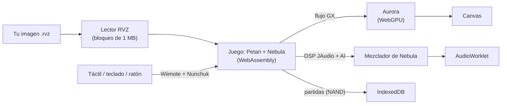

<div align="center">


# Galaxy Web

**Super Mario Galaxy en el navegador: el código original del juego compilado a WebAssembly y dibujado con WebGPU.**

[](#estado)
[](#versión-010-experimental)
[](LICENSE)
[](#requisitos)

[**▶ Probar en el navegador**](https://gonzaloprogame.github.io/Super-Mario-Galaxy-Web/) ·
[Cómo conseguir el archivo](#tu-copia-del-juego) ·
[Estado](#estado) ·
[Compilar](#compilar-desde-el-código)


</div>

> [!IMPORTANT]
> **Este repositorio no contiene ningún archivo de Nintendo** (ni ROM, ni ejecutables, ni modelos, texturas o
> música). Para jugar necesitas **tu propia copia** de Super Mario Galaxy. El proyecto no está afiliado a Nintendo
> ni respaldado por Nintendo.

## Qué es

Un port experimental que ejecuta **la lógica original del juego** en el navegador, no un remake ni un clon:

- **El juego:** la decompilación [Petari](https://github.com/SMGCommunity/Petari), en el fork nativo de
  [Nebula](https://github.com/keepvaibin/nebula), compilada a WebAssembly con Emscripten.
- **Los gráficos:** el flujo GX del juego llega a [Aurora](https://github.com/encounter/aurora), que lo dibuja con el
  WebGPU del navegador.
- **El sonido:** el programa DSP JAudio del juego mezclado en el host (la implementación de Nebula) y reproducido con
  un `AudioWorklet`.
- **El disco:** la página lee tu imagen **RVZ** de Dolphin directamente, por trozos, sin claves de la consola ni
  conversión. El archivo nunca sale de tu navegador.



## Cómo jugar

1. Abre **[la página](https://gonzaloprogame.github.io/Super-Mario-Galaxy-Web/)** en Chrome o Edge (escritorio o
   Android) con WebGPU.
2. Elige tu archivo `.rvz` y el idioma, y pulsa **Arrancar el motor**.
3. Juega con los controles de la pantalla, o con teclado y ratón:

| Wiimote + Nunchuk | Teclado | Táctil / ratón |
|---|---|---|
| A / B | Espacio / Mayús | Botones A y B · clic / clic derecho |
| Palanca | W A S D | Palanca de la pantalla |
| Z / C | Z / C | Botones Z y C |
| Agitar (giro) | Q o E | Botón «Agitar» |
| Puntero | — | Tocar o mover el ratón sobre la pantalla |
| Cruceta, +, −, HOME, 1, 2 | Flechas, P, M, H, 1, 2 | Botones de la pantalla |

Las partidas se guardan en el navegador (IndexedDB) y se recuperan al volver.

### Tu copia del juego

Necesitas una copia de seguridad de **tu** disco de Super Mario Galaxy **(Norteamérica, RMGE01)** en formato
**RVZ** de [Dolphin](https://dolphin-emu.org/), con compresión Zstandard (la de Dolphin por defecto) o sin
compresión. Las imágenes ISO y WBFS guardan la partición cifrada: conviértelas a RVZ en Dolphin («Convertir
archivo…»). Detalles en [`docs/ARCHIVOS_DEL_JUEGO.md`](docs/ARCHIVOS_DEL_JUEGO.md).

### Requisitos

- Navegador con **WebGPU** y `SharedArrayBuffer`: Chrome o Edge recientes (escritorio o Android).
- Unos 1,1 GB de memoria para el motor.

## Estado

**Versión 0.1.0-experimental.** Se puede jugar el comienzo del juego, con limitaciones.

| | |
|---|---|
| ✅ Arranque, pantalla de título, elección de archivo y partidas guardadas | Comprobado con el disco |
| ✅ Prólogo y primer nivel, con el escenario completo | Comprobado con el disco, en escritorio y Android |
| ✅ Controles: táctil, teclado y ratón (puntero) | Comprobado en Android |
| 🧪 Sonido (música y efectos) | Mezcla comprobada por sus niveles; pendiente de oír en un dispositivo |
| 🧪 Rendimiento | Unos 27 fps en un teléfono Android en el primer nivel, con mejoras recientes sin medir allí |
| ⏳ Vídeos THP, más allá del primer nivel, otras regiones | Sin probar |

Más detalle en [`docs/MOTOR_WEB.md`](docs/MOTOR_WEB.md) y la hoja de ruta en
[`docs/HOJA_DE_RUTA.md`](docs/HOJA_DE_RUTA.md).

### Versión 0.1.0-experimental

- El juego llega al primer nivel y se ve completo (clear quad del EFB y matrices por índice corregidos en Aurora).
- Sonido: el mezclador JAudio de Nebula y un `AudioWorklet`.
- Arranque rápido: el lector RVZ lee la imagen en bloques (en Android las lecturas pasaban de 85 s).
- Rendimiento: datos de cada fotograma enviados sin mapear 71 MB; procesado del flujo GX un 40 % más rápido.
- Interfaz nueva, con pantalla completa y volumen.

## Compilar desde el código

```sh
source <emsdk>/emsdk_env.sh                     # Emscripten 6.0.13
tools/fetch_sources.sh                          # fuentes de referencia en third_party/ (revisiones fijas)
tools/build_web.sh                              # compila y monta el sitio en build/site
python3 tools/serve.py 8080 build/site          # http://127.0.0.1:8080 (con COOP/COEP)
```

Pruebas:

```sh
web/tests/run_os_tests.sh                       # capa nativa en wasm (Node)
web/tests/run_rvz_tests.sh                      # lector RVZ (necesita cargo)
node web/tests/browser_smoke.mjs                # la página y el motor en Chromium
node web/tests/bridge_smoke.mjs build/site/bridge   # GX del juego -> Aurora, en Chromium
```

Versiones y dependencias en [`docs/ENTORNO.md`](docs/ENTORNO.md).

## Documentación

| Documento | Contenido |
|---|---|
| [`docs/MOTOR_WEB.md`](docs/MOTOR_WEB.md) | El motor con el juego real: hallazgos, correcciones y rendimiento |
| [`docs/ARQUITECTURA_WEB.md`](docs/ARQUITECTURA_WEB.md) | Arquitectura del port |
| [`docs/PUENTE_FIFO.md`](docs/PUENTE_FIFO.md) | El flujo GX del juego dibujado por Aurora, y los parches de Aurora |
| [`docs/BACKEND_WEBGPU.md`](docs/BACKEND_WEBGPU.md) | Aurora sobre el WebGPU del navegador |
| [`docs/RVZ.md`](docs/RVZ.md) | Lectura de la imagen RVZ |
| [`docs/COMPILACION_WASM.md`](docs/COMPILACION_WASM.md) | Compilación a wasm: resultados y errores |
| [`docs/DIAGNOSTICO.md`](docs/DIAGNOSTICO.md) | Análisis de Petari y Nebula |
| [`docs/ARCHIVOS_DEL_JUEGO.md`](docs/ARCHIVOS_DEL_JUEGO.md) | Cómo aportar legalmente los archivos del juego |
| [`docs/ENTORNO.md`](docs/ENTORNO.md) | Herramientas e instalación |
| [`docs/HOJA_DE_RUTA.md`](docs/HOJA_DE_RUTA.md) | Hitos y próximos pasos |

## Estructura

| Ruta | Contenido |
|---|---|
| `web/shell/` | La página: interfaz, controles, presentación y sonido |
| `web/host/` | El host de `nebula_game_api.h`: disco RVZ, NAND, Wiimote, audio y puente a Aurora |
| `web/aurora/` | Aurora para el navegador: CMake y parches |
| `web/platform/` | Capa de plataforma web (sustitutos de la capa nativa de Nebula) |
| `web/game/`, `web/engine/`, `web/cmake/` | Compilación del módulo de juego y del motor |
| `web/bridge/`, `web/tests/` | Pruebas |
| `tools/` | Descarga de fuentes, compilación, servidor y utilidades |
| `third_party/` | Copias de referencia sin modificar (no versionadas) |

## Créditos

- [**Petari**](https://github.com/SMGCommunity/Petari): la decompilación de Super Mario Galaxy (CC0 1.0).
- [**Nebula**](https://github.com/keepvaibin/nebula): el fork nativo, su SDK y su mezclador de audio (GPL-3.0).
- [**Aurora**](https://github.com/encounter/aurora): la implementación de GX sobre WebGPU (MIT).
- [**Dolphin**](https://dolphin-emu.org/): el formato RVZ; [**Zstandard**](https://github.com/facebook/zstd).
- [**coi-serviceworker**](https://github.com/gzuidhof/coi-serviceworker) (MIT): aislamiento entre orígenes en
  GitHub Pages.

## Licencia

**GPL-3.0** ([`LICENSE`](LICENSE)), la licencia de Nebula, del que este trabajo deriva. Petari es CC0 1.0; Aurora
es MIT. Las restricciones de Petari sobre contribuciones generadas por IA se aplican a contribuciones a Petari; este
proyecto no envía cambios a Petari ni genera código de decompilación: su código es la capa de plataforma web.

Super Mario Galaxy es una marca de Nintendo. Este proyecto no distribuye ningún recurso del juego.
