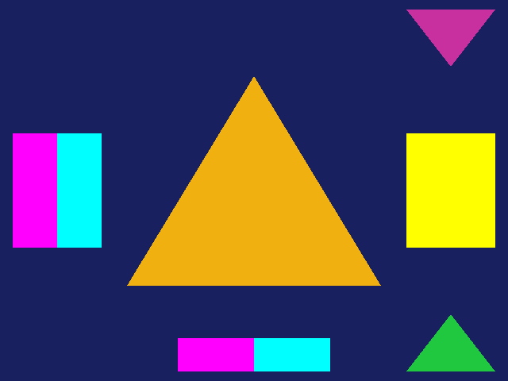

# Puente FIFO: la GX del juego dibujada por Aurora

Resultados medidos el 2026-10-28 (Emscripten 6.0.13, Chromium 153 con WebGPU por software).

## Qué conecta

El módulo de juego escribe el flujo de comandos FIFO de la consola en el anillo de Nebula (`native/sdk/gx/gx_fifo.c`)
y entrega al host cada tramo al vaciarlo (`gx_submit`), con los marcadores de sincronización y de fin de dibujo en su
posición (`gx_pe_marker`). El puente (`web/host/aurora_bridge.cpp`) lleva ese flujo a Aurora, que lo interpreta y lo
dibuja en el WebGPU del navegador:

```
 hilo de simulación (juego)                           hilo de render (Aurora, dueño del dispositivo WebGPU)
 SDK GX del juego → anillo de Nebula → gx_submit ──▶ cola fija ──▶ fifo::write_data → nebula_game_gx_release
                                      gx_pe_marker ─▶            ─▶ fin de dibujo: aurora_end_frame → nebula_game_gx_event
```

Como en Nebula, el renderizador es otro hilo; aquí, además, porque los objetos WebGPU pertenecen al hilo que los crea.
La cola entre ambos tiene tamaño fijo y el lado del juego no asigna memoria (ver "Un solo binario").

## Un solo binario con el juego y Aurora

Nebula mantiene el juego en su propio módulo nativo. En wasm hay un único enlace, y se midieron dos conflictos:

1. **156 símbolos C definidos dos veces** (`llvm-nm` sobre las bibliotecas): la API GX/VI de Aurora (`lib/dolphin`) y
   el SDK de Revolution del juego implementan las mismas funciones. Excluir los ficheros de API de Aurora no sirve:
   comparten fichero con internos que el renderizador necesita (`aurora::gx::copy_tex`, `__gx`,
   `aurora::vi::configured_fb_size`; errores de enlace reales). Solución: en todas las unidades de Aurora esos 156
   nombres se renombran a `aurora_<nombre>` con una cabecera incluida por la fuerza
   (`web/aurora/include/aurora_api_renames.h`, generada por `tools/gen_aurora_renames.py`). El binario tiene así una
   sola API GX, la del juego, y Aurora conserva la suya completa con otro nombre.
2. **`operator new`/`operator delete` globales**: el juego los define (`JKRHeap.cpp`: asignan en el heap JKR actual,
   dentro de la arena). En un enlace estático sustituirían a los de libc++ para todo el binario, y Aurora asignaría en
   los heaps del juego. El enlace dinámico de Emscripten no lo resuelve: es experimental con pthreads (aviso del
   compilador), una prueba mínima falló en ejecución (`RuntimeError: unreachable`), y `operator new` se exporta aunque
   la visibilidad sea oculta. Solución: `-Wl,--wrap` de las cuatro formas que define el juego y
   `web/platform/operator_new_wasm.cpp`:
   - `new` usa JKRHeap solo en el hilo de simulación del juego una vez arrancado (registrado en el primer cambio de
     fiber); en cualquier otro caso, `malloc`;
   - `delete` decide por la dirección: la memoria JKR está siempre dentro de la arena y la de `malloc` nunca.
   Verificado con una prueba mínima: un `std::vector` del host acaba en `malloc` y un objeto del "juego" en su arena.
   Regla que impone: las llamadas del juego al host en su hilo (`gx_submit`, etc.) no usan `new` (el host es C y la
   cola del puente es fija).

`web/CMakeLists.txt` compila todo junto: módulo de juego, Aurora (con `-pthread` en todas sus unidades y
dependencias, necesario para enlazarlas en un binario con memoria compartida) y el puente.

## Adaptaciones de Aurora para el flujo de hardware

La API de Aurora escribe parte del estado con comandos propios; el SDK del juego escribe los registros de hardware tal
cual. Dos diferencias aparecieron al dibujar con la GX del juego:

| Parche | Error real |
|---|---|
| `0007-clamp-viewport-depth` | El SDK escribe el *viewport* XF como escala y desplazamiento en unidades de 24 bits; reconstruido, el rango de profundidad quedaba un redondeo por debajo de 0 y WebGPU rechazaba `SetViewport(…, -0.000000, 1)`. Se acota a [0, 1], como hace el hardware. |
| `0008-hardware-scissor-viewport-offsets` | El hardware **resta** el desplazamiento de caja del *scissor* (el SDK escribe el *scissor* en +342 y el desplazamiento como (x + 342)/2); Aurora lo sumaba, con su API escribiéndolo negado. Con el flujo del juego el *scissor* quedaba en x = 684, fuera del EFB, y no se dibujaba nada. El centro del *viewport* es +342 en el SDK y Aurora usaba 340 (2 píxeles de desfase). Aurora pasa a la convención del hardware en los dos extremos: su API y su reconstrucción. |
| `0009-guest-memory-arrays-and-display-lists` | Ver "Fase 2" más abajo: Aurora rechazaba las bases de *array* del hardware (`CP_REG_ARRAYBASE_ID is not supported`, escritas ya por `GXInit`) e ignoraba `CALL_DL`. |
| `0012-guest-memory-display-copies` | Ver "Fase 2": la copia a pantalla (`GXCopyDisp`) era un *stub* de Aurora: ni guardaba el fotograma ni borraba el EFB. |
| `0011-guest-memory-texture-copies` | Ver "Fase 2": Aurora solo hacía copias del EFB a textura con sus propios comandos (origen, tamaño, formato y puntero de destino); los registros del hardware que escribe `GXCopyTex` (BP 0x49, 0x4A, 0x4B y la orden 0x52) no tenían efecto y la textura copiada salía negra. |
| `0010-guest-memory-textures` | Ver "Fase 2": Aurora leía el tamaño y el formato de las texturas de los registros, pero no su imagen (BP `image3`), ni las TLUT cargadas en TMEM (BP 0x64/0x65) ni la TLUT que elige cada textura (BP 0x98–0x9B, 0xB8–0xBB). Las texturas del juego salían negras. |

## Prueba: `web/tests/bridge_smoke.mjs`

`web/bridge/gx_bridge_scene.c` se compila con las opciones del módulo de juego y dibuja con su GX (Petari) la misma
escena que la demo de Aurora: un triángulo con color de vértice sobre el color de borrado. No se ejecuta código ni
datos del juego: `web/bridge/bridge_main.c` arranca el núcleo OS del módulo (`nebula_os_boot`) con esa escena como
"main" del juego. `GXInit`, la configuración y el dibujo son los del SDK; `GXDrawDone` espera al fin de dibujo que
devuelve el puente.

El fotograma termina como el de un juego: `GXCopyDisp` copia el EFB entero a un XFB y borra el EFB, y la escena dibuja
después un marcador. Los colores de la escena se leen **del XFB**, con la API de lectura de copias de Aurora, en el
formato en que el hardware lo habría dejado en memoria (aquí RGBA8 en bloques de 4×4, decodificado por el puente). El
EFB se lee al final del fotograma, después del borrado:

| Punto | Esperado | Leído |
|---|---|---|
| XFB, esquina (16, 16) | (24, 32, 96) | `0xFF182060` |
| XFB, centro del triángulo (320, 272) | (240, 176, 16) | `0xFFF0B010` |
| XFB, fondo (96, 408) | (24, 32, 96) | `0xFF182060` |
| XFB, triángulo de *arrays* indexados (568, 444) | (32, 200, 64) | `0xFF20C840` |
| XFB, triángulo de la lista de visualización (568, 36) | (200, 48, 160) | `0xFFC830A0` |
| XFB, textura RGB565, mitad izquierda (44, 240) | (255, 0, 255) | `0xFFFF00FF` |
| XFB, textura RGB565, mitad derecha (100, 240) | (0, 255, 255) | `0xFF00FFFF` |
| XFB, textura C8 con TLUT RGB565 (568, 240) | (255, 255, 0) | `0xFFFFFF00` |
| XFB, copia del EFB, arriba a la izquierda (272, 405) | fondo copiado (24, 32, 96) | `0xFF182060` |
| XFB, copia del EFB, abajo a la izquierda (272, 447) | magenta copiado (255, 0, 255) | `0xFFFF00FF` |
| XFB, copia del EFB, abajo a la derecha (368, 447) | cian copiado (0, 255, 255) | `0xFF00FFFF` |
| XFB, donde está el marcador (320, 48) | fondo: el marcador se dibujó después de la copia | `0xFF182060` |
| EFB tras la copia, esquina (16, 16) | (24, 32, 96) | `0x00182060` |
| EFB tras la copia, donde estaba el triángulo (320, 272) | (24, 32, 96): la copia borró el EFB | `0x00182060` |
| EFB tras la copia, marcador (320, 48) | (250, 120, 0) | `0x00FA7800` |
| `GXPeekARGB` de la escena en la *callback* del token, (320, 272) | triángulo (240, 176, 16) | `0x00F0B010` |
| `GXPeekZ` de la escena en la *callback* del token, (320, 272) | profundidad del triángulo: z = −0,5 llevado a [0, 1] | `0x800000` |
| `GXPeekARGB` de la escena tras la copia a pantalla, (320, 272) | color de borrado | `0x00182060` |
| `GXPeekZ` de la escena tras la copia a pantalla, (320, 272) | profundidad borrada | `0xFFFFFF` |
| `GXPeekARGB` de la escena, marcador (320, 48) | (250, 120, 0) | `0x00FA7800` |

El alfa del EFB es 0 porque el `GXInit` del SDK deja el EFB en un formato sin alfa, como en la consola; la copia RGBA8
al XFB lo escribe opaco. Las filas de *arrays*, lista, texturas, copias y XFB son de la fase 2 (abajo).

Las lecturas no se toman del primer fotograma. Aurora empieza cada fotograma borrando el EFB con el color de borrado
que ya tiene, y en el primero aún es el suyo por defecto (negro), no el de la escena. Al añadir la copia del EFB, la
primera lectura en llegar resultó ser la del primer fotograma y la prueba vio el fondo negro. Lo comprobé esperando a
que pasaran diez fotogramas: el fondo salía con su color. Antes, la primera lectura llegaba por casualidad de un
fotograma posterior. Era un fallo de la prueba, no de Aurora ni de la copia.

La demo de la API de Aurora (`web/tests/aurora_smoke.mjs`) sigue pasando con todos los parches.

Error encontrado al escribir la prueba: `exit()` desde el juego ejecuta los destructores estáticos de C++ en el hilo
de la página mientras el hilo de render sigue activo, y uno de ellos espera indefinidamente (pila obtenida pausando el
hilo con el depurador de Chrome: `exitOnMainThread` → `exitRuntime` → `__funcs_on_exit`). La prueba publica el
resultado en la página sin terminar el proceso. El motor con gráficos (`docs/MOTOR_WEB.md`) sí cierra ordenadamente
(`smg_bridge_stop`): el hilo de render cierra su fotograma, apaga Aurora y termina antes de `exit()`.

## Fase 2: recursos por dirección física

El SDK del juego referencia memoria con direcciones físicas de 32 bits (`GX_PHY_ADDR`, que en Nebula es
`__NebulaToPhysical`: MEM1 desde 0, MEM2 desde 0x10000000 y la imagen del módulo en la ventana 0x08000000). Aurora las
recibía por sus propios comandos, con punteros del host y tamaños.

### Hecho: *arrays* de vértices y listas de visualización (parche 0009)

- **Resolución.** Aurora gana una interfaz mínima, `aurora/guest_memory.h`: `aurora_set_guest_resolver` registra una
  función que traduce una dirección física a memoria del host y dice cuántos bytes son legibles desde ahí. El puente
  (`resolve_guest` en `web/host/aurora_bridge.cpp`) la implementa con `nebula_game_memory_regions`. Sin resolvedor,
  Aurora se comporta como antes (con un mensaje de error que nombra la dirección).
- **Bases de *array* (CP 0xA0–0xAF).** La base resuelta pasa a ser el *array* del atributo, big-endian (el shader de
  Aurora ya lleva el orden de bytes por *array*). Los registros no tienen tamaño: antes de cada dibujo se leen sus
  índices (8 o 16 bits, tres por vértice con `GX_NRM_NBT3`) y el *array* se sube hasta el índice máximo alcanzado por
  la `stride` más el tamaño del elemento, acotado a la memoria disponible. Si un dibujo necesita más de lo subido, el
  *array* se vuelve a subir (y ese dibujo no se fusiona con el anterior). Las cargas indexadas de matrices
  (`LOAD_INDX`) comprueban sus límites contra la memoria disponible.
- **`CALL_DL`.** La lista se resuelve y se procesa en línea, con el mismo intérprete. Como en el hardware, una lista
  no puede llamar a otra (se registra un aviso y se ignora). Una lista que excede la memoria disponible se ignora con
  un error.

Prueba (`bridge_smoke.mjs`, tabla de arriba): la escena añade un triángulo dibujado con `GXSetArray` + índices de 8
bits (posiciones como f32 big-endian, como en los archivos del juego, y colores RGBA8; la entrada 0 de cada *array*
es un señuelo blanco que no se indexa y el triángulo usa las entradas 1, 3 y 2, así que el *array* tiene que leerse
hasta su última entrada) y otro grabado con `GXBeginDisplayList`/`GXEndDisplayList` (64 bytes) y llamado cada
fotograma con `GXCallDisplayList`. **Control negativo:** con el resolvedor desactivado, esas dos comprobaciones fallan
(el EFB conserva el color de borrado) y Aurora registra las direcciones que no pudo resolver; con él, la ejecución
no registra ni un aviso de Aurora. Siguen pasando los tests del núcleo OS, la página del motor y la demo de Aurora
(con las dos variantes TEV).

Limitación conocida: en el modo `DRAIN`, Aurora interpreta el flujo al cerrar el fotograma, no cuando el juego lo
envía, así que lee la memoria de los *arrays* y las listas algo más tarde que la GPU de la consola. Para datos que el
juego reescribe dentro de un mismo fotograma a la misma dirección, el resultado podría diferir; con el juego real se
comprobará (la subida de un *array* se invalida en cada fotograma, con `GXInvalidateVtxCache` y al cambiar su base).

### Hecho: texturas y TLUT (parche 0010)

- **Texturas.** Aurora ya leía de los registros de cada mapa de textura el tamaño y el formato (`Image0`), y el filtrado
  y el LOD (`Mode0`/`Mode1`). El parche añade la imagen: la dirección física / 32 de `Image3`, resuelta con el mismo
  resolvedor. Las *mipmaps* se deciden como en el hardware, por el filtro de reducción (los filtros `*_MIP_*`), con el
  número de niveles del LOD máximo. Si la imagen no cabe en la memoria disponible, la textura se descarta con un error
  que da su tamaño, formato y dirección.
- **TLUT.** Una carga (BP 0x64: dirección física / 32; BP 0x65: desplazamiento en TMEM y número de entradas en
  unidades de 16) se registra por su desplazamiento en TMEM, como en el hardware; cada textura elige su TLUT por
  desplazamiento y formato (BP 0x98–0x9B y 0xB8–0xBB) y recibe su propia ranura de TLUT en Aurora.
- **Cuándo.** Los registros se escriben en cualquier orden (`GXLoadTexObj` escribe seis); los mapas que cambiaron se
  reconstruyen una sola vez, justo antes del siguiente dibujo (`sync_guest_textures`).
- **Caché.** Sin identidad de objeto: la caché de Aurora por contenido calcula el hash de los datos (XXH3) cada vez que
  la textura se enlaza (al cambiar los registros de textura, con `GXInvalidateTexAll` (BP 0x66) y en cada fotograma).
  Así, si el juego reescribe la textura en la misma dirección, se detecta. El precio es calcular el hash una vez por
  enlace; con el juego real se medirá si hace falta una identidad por dirección invalidada con BP 0x66, que es lo
  que hace la caché de texturas del hardware.

Prueba (`bridge_smoke.mjs`, tabla de arriba): dos cuadrados con texturas generadas por la escena (sin datos del juego)
y filtrado puntual. El primero es una textura RGB565 de 8×8 cuyas mitades izquierda y derecha tienen colores distintos:
comprueba el formato, el orden de bytes y el mosaico de bloques de 4×4 píxeles. El segundo es una textura C8 de 8×8
que usa en todos sus téxeles el índice 5 de una TLUT RGB565 cargada con `GXLoadTlut`; las demás entradas son negras.
**Control negativo:** compilado sin el parche 0010, esas tres comprobaciones fallan (el EFB lee negro) y las demás
pasan. Con él pasan todas y Aurora no registra avisos.

No cubierto todavía: las texturas precargadas en TMEM (`GXPreLoadEntireTexture`, `Image1`/`Image2`); los demás formatos
pasan por los decodificadores de Aurora, que esta prueba no comprueba uno a uno.

### Hecho: copias del EFB a textura (parche 0011)

- **Registros.** En la orden de copia (BP 0x52, sin el bit de copia a pantalla), el origen se lee de BP 0x49 (x, y) y
  0x4A (ancho − 1, alto − 1), y el destino de 0x4B (dirección física / 32), resuelto con el mismo resolvedor. El tamaño
  del destino no está en los registros: es el del origen, a la mitad si está activo el filtro de caja (bit 9).
- **Formato.** Se reconstruye el `GXTexFmt` desde el formato de 4 bits del PE (bits 4–6 y 3), la conversión de color
  (CCV 3: intensidad) y si la copia es de profundidad (`GXCopyTex` pone el EFB en formato Z24 para ella). Es la inversa
  exacta de `GXSetTexCopyDst` del SDK. Un formato que no corresponde a ninguno se rechaza con un error.
- **Cómo la usa una textura.** Aurora ya guardaba cada copia en la GPU, indexada por su puntero de destino, y una
  textura cuya imagen está en ese puntero toma la copia. Con el resolvedor, el destino de la copia y la imagen de la
  textura (parche 0010) son el mismo puntero del host, así que encajan sin más cambios. Tras la copia se fuerza a
  enlazar de nuevo las texturas, por si una ya enlazada estaba en esa dirección.

Prueba (tabla de arriba): se copian como RGBA8 los 64×64 píxeles que hay en (40, 136): arriba es fondo y abajo el
borde superior del cuadrado RGB565, magenta a la izquierda y cian a la derecha. La copia se dibuja como textura en un
rectángulo. Comprueba la posición del origen, la orientación (arriba y abajo) y los colores. **Control negativo:** sin
el parche 0011 fallan esas tres comprobaciones (el rectángulo sale negro). Con él pasan las quince, en tres ejecuciones
seguidas y sin avisos de Aurora.

Límites de este enfoque, que habrá que comprobar con el juego real:

- La copia vive solo en la GPU: no se escribe en la memoria del juego. Si la CPU lee el destino (algo que la consola
  permite), verá lo que hubiera antes. Si la CPU reutiliza ese búfer para otra textura, Aurora seguirá dando la copia,
  porque no hay ninguna señal del juego que lo indique.
- Solo se ha probado RGBA8 desde un EFB de color. Las copias de profundidad, de intensidad, con filtro de caja y con
  borrado (`clear`) pasan por el código de Aurora, pero esta prueba no las comprueba.

### Hecho: copia a pantalla (parche 0012)

- **Qué hace.** `GXCopyDisp` es la misma orden de copia con el bit 14: el fotograma pasa al XFB, la memoria de la
  que el VI lee la imagen. Usa los mismos registros de origen y destino. El ancho del destino es el del origen y el
  alto se escala con BP 0x4E cuando el bit 10 está activo (`__GXGetNumXfbLines` del SDK). El borrado (bit 11) es como
  el juego borra el EFB entre fotogramas: se aplica tras la copia con las máscaras de escritura del momento (el SDK
  activa la de profundidad para ello).
- **Formato.** La consola escribe el XFB en YUV 4:2:2 para el VI. Aquí se guarda en RGBA8, en la GPU y bajo la
  dirección del XFB, como cualquier copia: nadie lee un XFB desde la CPU, y el host lo presentará.
- **Dibujos que esperan su *pipeline*.** El puente activa `AuroraSetDrawsBlocking`. Sin hilo de *pipelines*
  (parche 0004), Aurora compila unos pocos por fotograma y descarta los dibujos cuyo *pipeline* aún no existe. La
  prueba lo destapó: en los primeros fotogramas se perdía el borrado de la copia a pantalla. El EFB conservaba el
  triángulo del fotograma anterior; en el fotograma 60, en cambio, ya se borraba. Con la espera no se pierde ningún
  dibujo; a cambio, el fotograma se detiene la primera vez que aparece un *pipeline*. Con el juego real habrá que
  medir esa pausa y decidir si compensa (por ejemplo, con una caché persistente de *pipelines*).

Prueba: la tabla de arriba. **Controles negativos:** sin el parche 0012 no existe el XFB (Aurora registra «STUB:
display copy is not implemented» y la lectura del XFB falla), y la prueba falla. Sin la espera de *pipelines* falla
la comprobación del borrado (el EFB conserva el triángulo). Con ambos pasan las 19 comprobaciones, en tres ejecuciones
seguidas y sin avisos de Aurora.

Sin hacer todavía:

- El entrelazado por campos (bits 12–13), la gamma (bits 7–8) y el recorte (`GXSetCopyClamp`) de la copia se ignoran.

### Hecho: lecturas del EFB del juego (`gx_peek_efb`)

El juego lee píxeles del EFB con `GXPeekARGB`/`GXPeekZ`: el destello de la lente mira la profundidad donde está el
sol, en la *callback* de un token de sincronización. La respuesta no puede esperar: el flujo que debe leer aún está
en la cola de Aurora, y Aurora solo lee el EFB cuando el fotograma ya se ha enviado a la GPU. El puente
(`smg_bridge_peek_efb`) responde como los «campos publicados» de Nebula:

- Cada lectura es un punto de un **canal**: su token, o 0 si el juego lee fuera de una *callback*. El juego recibe el
  valor de la última captura de ese punto (con un fotograma de retraso). Un punto que aún no se ha capturado da 0;
  Nebula, en ese caso, dibuja y lee en el momento, cosa que aquí no cabe.
- El puente captura los puntos de un canal **en la misma posición del flujo** en los fotogramas siguientes. Para un
  token, al llegar a ese token, donde la GPU de la consola se detuvo para la *callback*. Para el canal 0, donde el
  juego hizo su primera lectura del fotograma. Las órdenes de lectura de Aurora siguen el orden de las del juego.

Prueba (tabla de arriba): la escena coloca un token tras dibujar y en su *callback* lee el color y la profundidad del
triángulo. Tras la copia a pantalla, que también borra la profundidad, vuelve a leer sin token. Los dos pares de
valores difieren, así que cada captura se ha tomado en su sitio. **Control negativo:** capturando el canal del token
al final del fotograma, las lecturas del token devuelven el EFB ya borrado y fallan esas dos comprobaciones. Con la
posición correcta pasan las 24, en tres ejecuciones seguidas.

Límites: ocho canales con 16 puntos cada uno; un punto nuevo da 0 durante su primer fotograma; en el canal 0, las
lecturas de un fotograma hechas en posiciones distintas se capturan todas en la primera.

### Hecho: presentación del XFB en la página

El VI de Nebula llama a `vi_frame` en cada retrace con la dirección física del XFB que muestra. El puente
(`smg_bridge_vi_frame`, `present`) lee de vuelta, al final de cada fotograma, la copia a pantalla de esa dirección
(RGBA8 en bloques, con `aurora_guest_copy_size`, parche 0013, para su tamaño). La pasa a filas RGBA y la envía a la
página por el `BroadcastChannel` «smg-present». `web/shell/present.js` la pinta en un `<canvas>` 2D. Este camino no
necesita presentar WebGPU en un canvas, así que funciona en cualquier navegador con WebGPU y se puede verificar aquí.
El precio es una lectura de 1,2 MB por fotograma y uno o dos fotogramas de retraso.



*La escena de prueba (generada por el propio test, sin datos del juego) tal como la pinta la página.*

Prueba: la escena hace lo que un juego al final de cada fotograma (`VISetNextFrameBuffer`, `VISetBlack(FALSE)`,
`VIFlush`), y el host del puente da un retrace de 60 Hz. La prueba lee **el canvas de la página** en los 12 puntos del
XFB, con los mismos colores, y comprueba el tamaño (640×480): 38 comprobaciones en total, en tres ejecuciones seguidas.
**Control negativo:** sin el servicio `vi_frame` la página no pinta ningún fotograma y la prueba falla.

Un error de la prueba encontrado aquí: la escena dejaba de dibujar en cuanto tenía su resultado, y la presentación,
que va uno o dos fotogramas por detrás, a veces no llegaba a enviar ninguno. Ahora la escena sigue dibujando, como un
juego.

Pendiente: la presentación directa de WebGPU en un canvas (`OffscreenCanvas` del hilo de render), que evita la lectura.
No se puede verificar en este entorno: ni Chromium *headless* ni Chromium normal en una pantalla virtual (Xvfb), con
nueve combinaciones de opciones, mantienen un dispositivo WebGPU que presente en un canvas; lo pierden también con una
página de JavaScript puro.

### Lo que falta

| Forma de hardware | En Aurora | Trabajo |
|---|---|---|
| Presentación directa en WebGPU | Lectura del XFB y canvas 2D | `OffscreenCanvas` en el hilo de render (verificable solo con GPU) |

Además: el `OffscreenCanvas` del hilo de render para mostrar la imagen en la página (hoy se dibuja fuera de pantalla), el
ritmo de fotogramas por el retrace (hoy el fotograma termina en cada fin de dibujo) y el cierre ordenado.
